# AppDeck

**One dashboard for every local app — start, stop, open, import, expose to the OS.**

AppDeck is a Go, stdlib-only launcher. Every app under `Apps/` gets a card on
one dashboard: web apps open in a tab or window, desktop apps launch and track
their process, and everything stays on this machine unless you explicitly flip
an app to Wi-Fi sharing. In its release form it is a **single executable**
that carries every app inside it, opens its own application window, and quits
cleanly when that window closes.

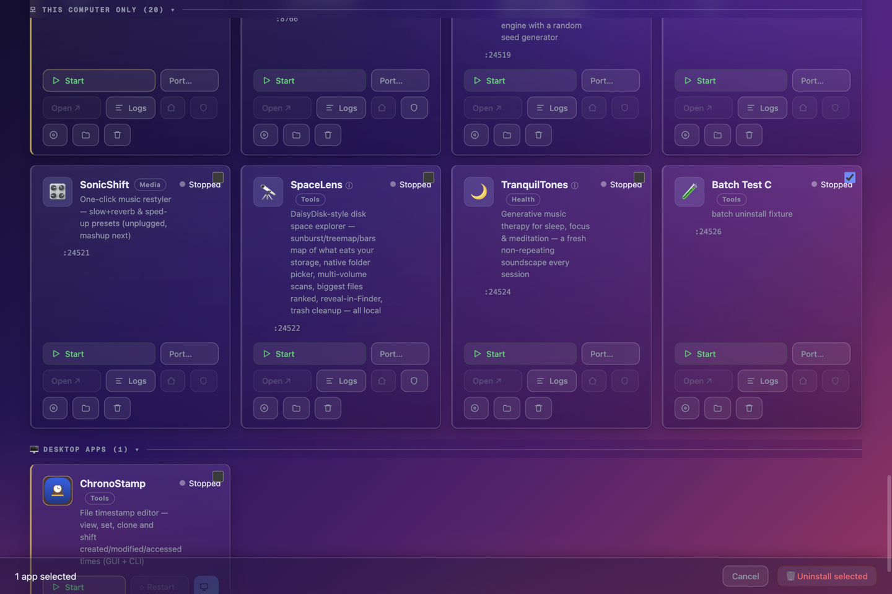
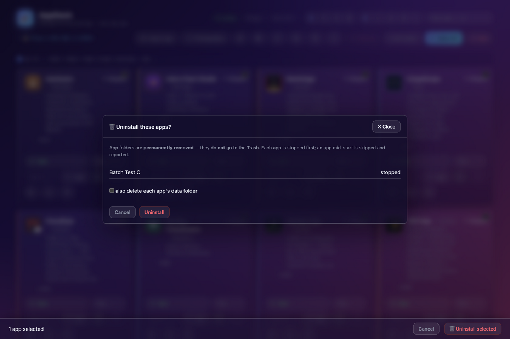

## What the launcher does

- **Cards, not config** — an app is any folder with an `app.json` manifest
  beside its entrypoint. Drop the folder into `Apps/` and it appears; Go and
  Rust apps build on first start, Python apps set up a venv, static pages are
  hosted in-process.
- **Import anything** — the 📥 button (or `POST /api/import`) takes archives
  (zip/tar.gz/rar/7z, nested archives unwrapped), macOS dmg's, portable
  binaries, AppImages, single HTML pages, folders, git repositories and URLs.
  Whatever arrives without an `app.json` gets one generated.
- **Expose to the OS (🔗)** — any installed app can be surfaced to the
  operating system itself: a `/Applications` symlink on macOS (Spotlight,
  Finder, Launchpad — a bare binary is wrapped into its own `.app` first),
  a Start-menu pin on Windows, a `.desktop` entry on Linux. The deck keeps
  owning the folder; the link follows updates and dies with uninstall.
- **Security at import** — every payload is scanned before it lands;
  findings pause the install for review, and macOS code signatures are
  verified (broken seals re-signed ad hoc, with a badge on the card).
- **Loopback by default** — apps bind `127.0.0.1` unless a card is dragged
  to the Wi-Fi section; DNS-rebinding hardening and per-app tokens are part
  of the app contract.
- **A deck you can move** — themes, backgrounds, icon packs, deck
  export/import, storage on another drive, per-app logs and data folders.

Full app contract and import matrix: **[AUTHORING.md](AUTHORING.md)** ·
per-language folder skeletons: **[GUIDE.md](GUIDE.md)**.

---

## The apps

### 🛡️ wTower

**See what your computer is really doing — and cut off anything you don't like.**

A live dashboard for your Mac, Windows PC or Linux box that answers three
questions in real time: *who is using my camera and mic?*, *which apps are
talking to the internet (and where)?*, and *how do I block them?* — all on one
page, all stored on your machine, nothing sent anywhere.

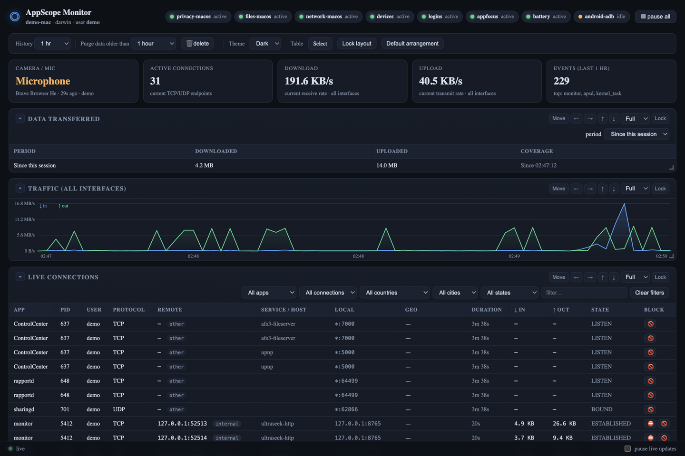
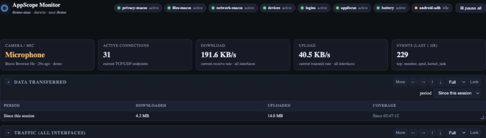
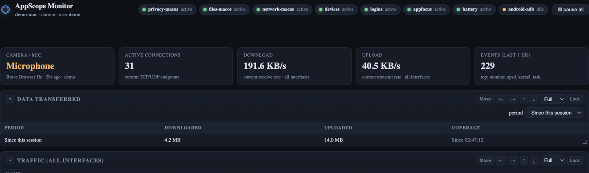
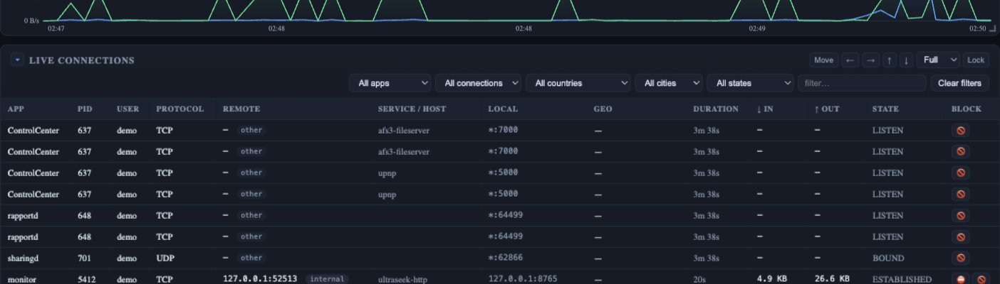

### 💧 wPurge

**The kettle-cleaner for your computer: buildup report, app uninstaller and
startup manager — and nothing is ever touched without your confirmation.**

Caches, logs, crash reports, leftover app traces, things that sneak into login
items… wPurge finds the scale, shows you exactly what it is, and moves it to
the Trash (never straight to deletion). Every session is journalled and
restorable.

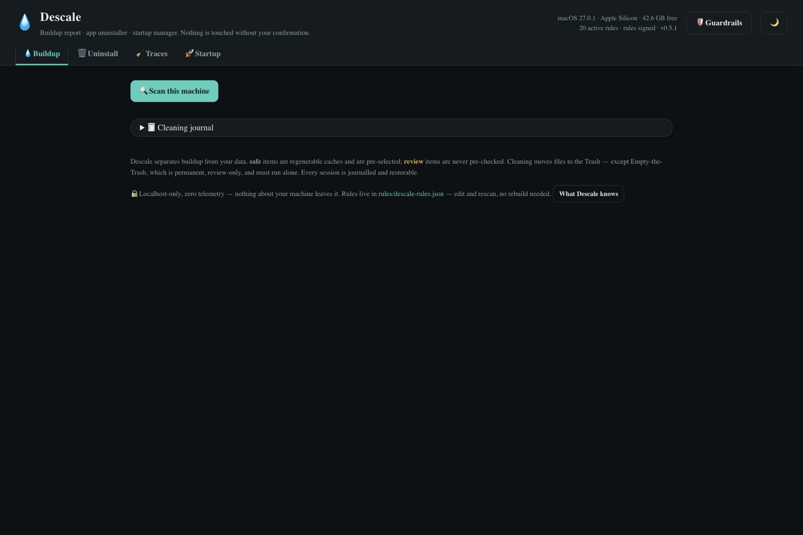
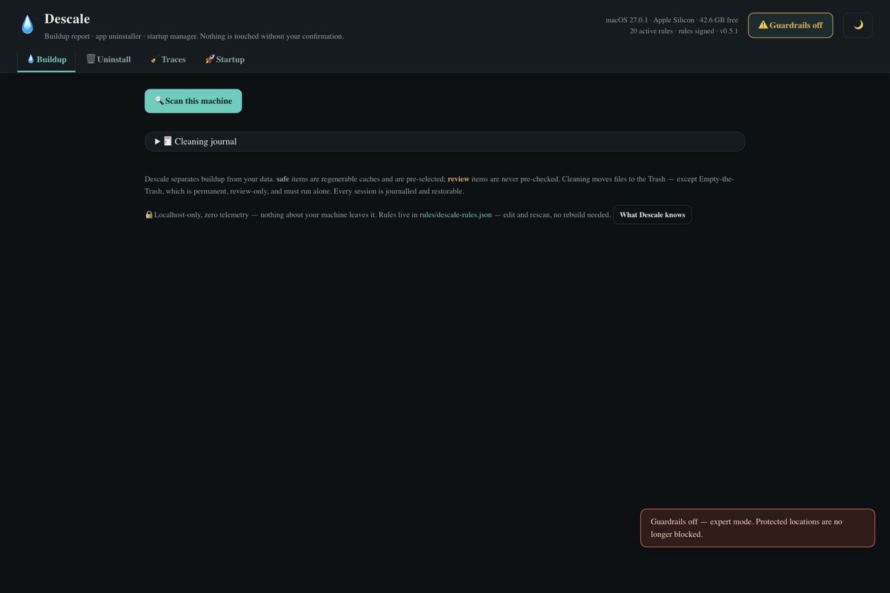
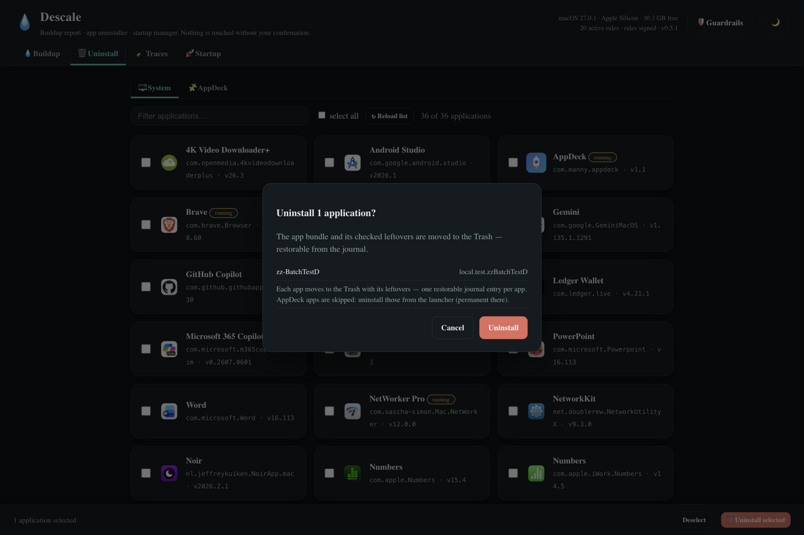

### 🔎 wScout

**Search GitHub for *apps*, not code — find a tool, see its real download
counts, grab the installer, run it.**

GitHub search finds repositories; wScout finds *runnable software*: it scans
releases for actual installers and artifacts (exe, dmg, apk, deb…), counts
real downloads from release data, filters by OS and maintenance, and downloads
what you pick — installing straight into the deck through AppDeck's import.

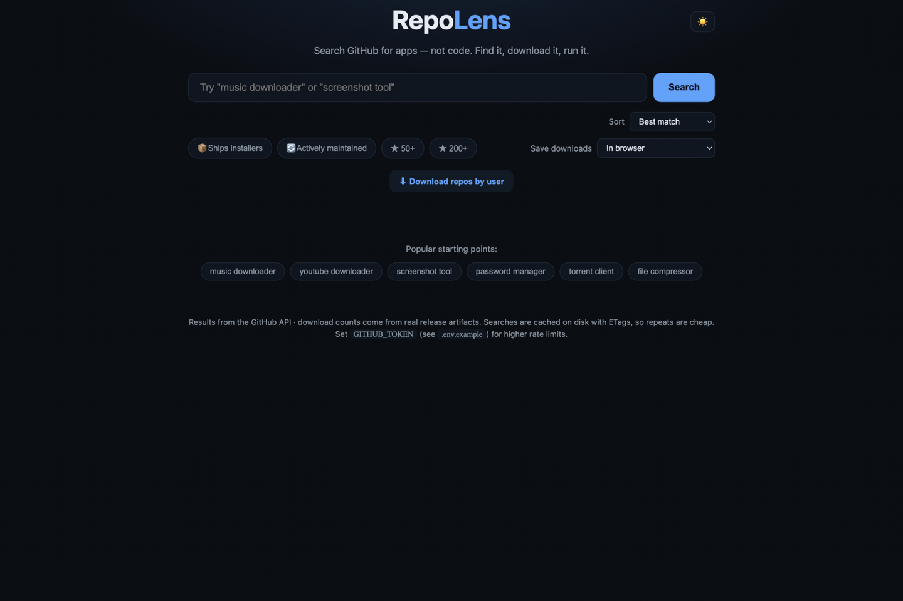
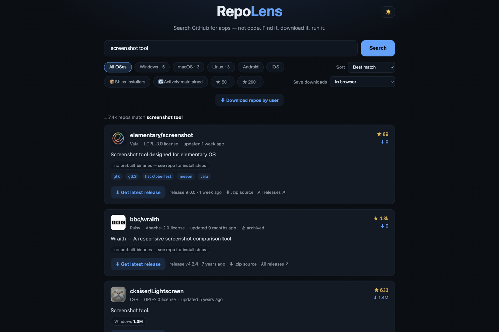

### 🚨 wHawk

**A host-compromise watchdog for your machine — RATs, MITM, rogue IPs, zombie
processes, keyloggers, exfiltration: checked every 15 seconds, alerted the
moment they appear.**

wHawk never talks to the internet. It watches *your own machine* —
processes, network listeners, ARP/DNS state, persistence locations, the
firewall — and enriches network findings with provider intelligence from
wGrid, its loopback-only partner.

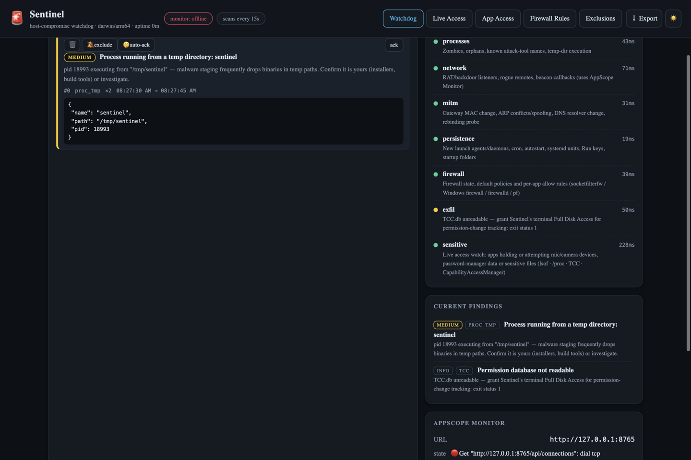
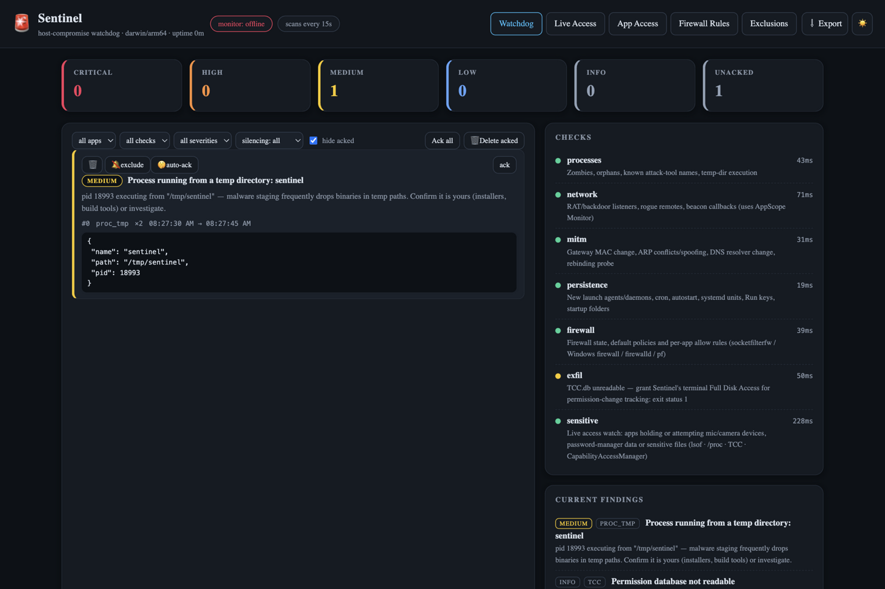

### 🚔 wGrid

**Known-IP intelligence for your machine — fetches provider network ranges
(Google, Cloudflare, GitHub, Apple, Meta…) and publishes them to wHawk over
loopback.**

Part of a security pair: **wHawk** watches your network but never talks to the
internet; **wGrid is the only half that does.** It downloads and refreshes the
published IP ranges of big providers, merges them into one local database,
answers *whose network is this IP?* instantly, and serves the data to wHawk
(and wTower's country blocking) on localhost.

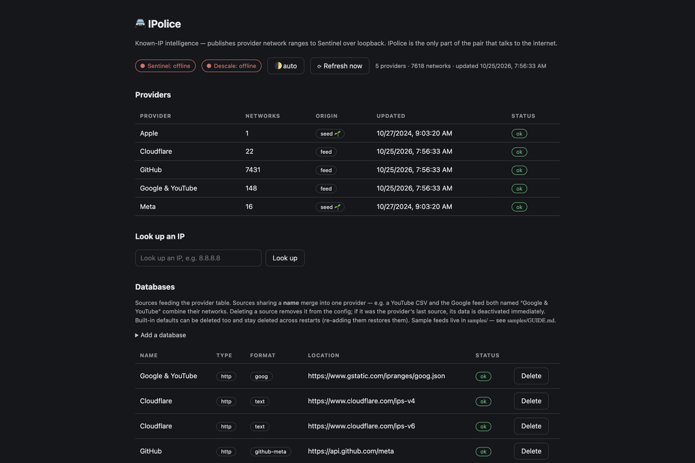
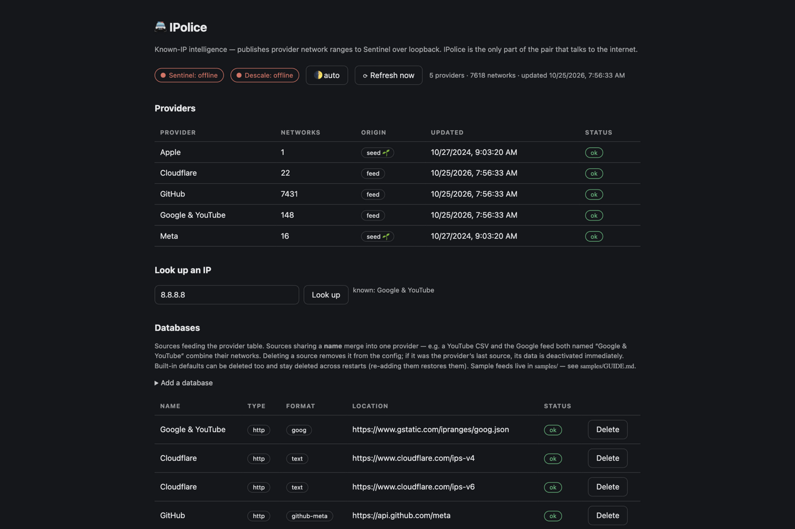

### 🔭 wGauge

**What's eating your disk? Scan any folder or volume and see it — sunburst,
treemap or bars — then drill in, reveal, and trash the hogs.**

A DaisyDisk-style explorer with a concurrent Go scanner underneath:
multi-root scans, top-K biggest files ranked instantly, click-to-zoom
navigation, and a deletion story you can trust — everything goes to the OS
Trash, never straight to deletion. Read-mostly by design, all local.

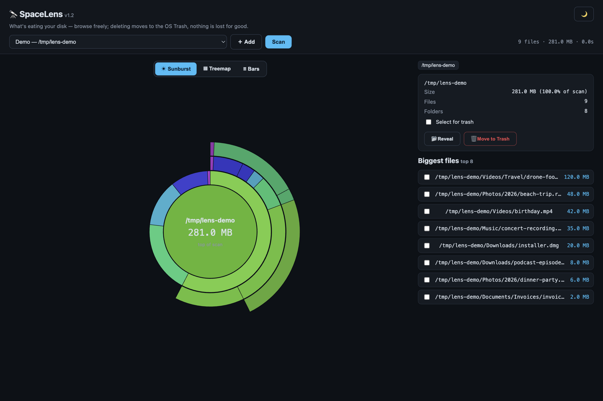
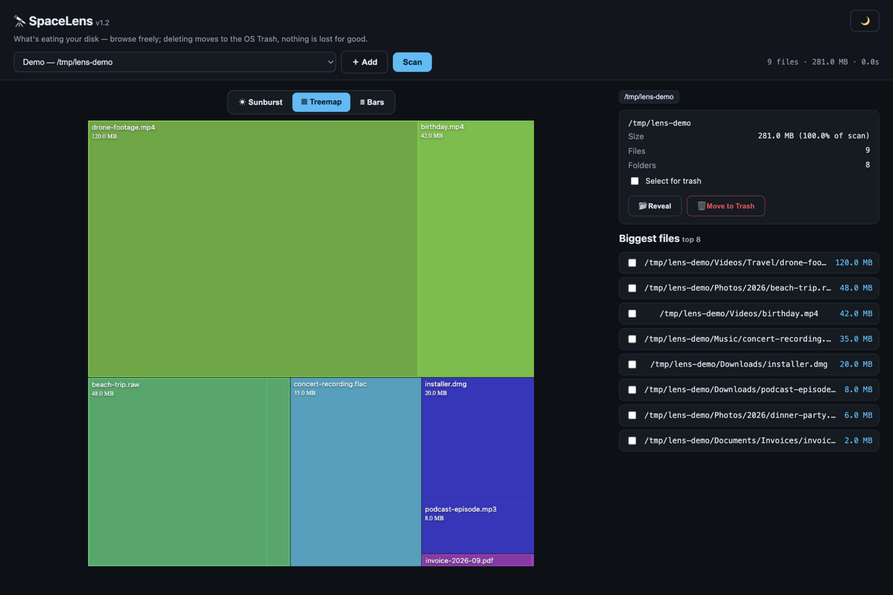

### 🔥 Token Report

**Which task burned the most tokens? — a local dashboard over your AI
agents' logs: cost estimates, token mix, peak hours, per-project totals.
Zero AI calls; everything is read from disk.**

Agents like Claude Code write structured session logs. Token Report scans
those folders locally, rebuilds every session, and answers the questions your
bill raises: which task, which project, which hours.

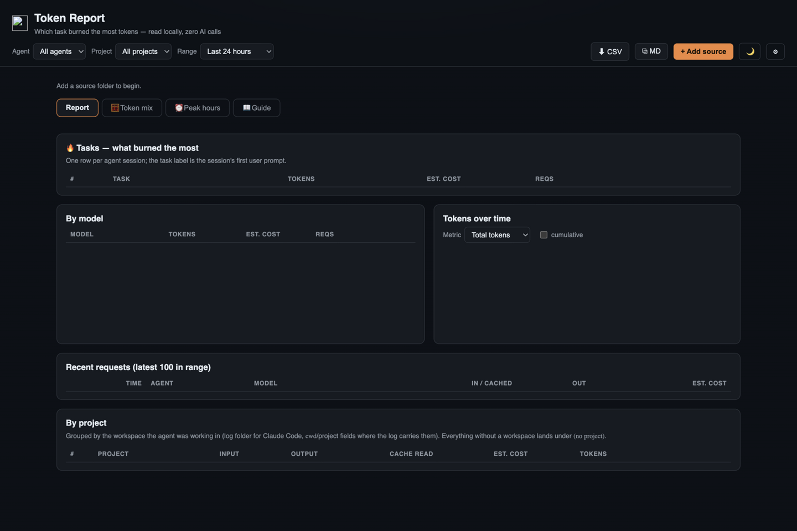

### 🛰️ Wi-Fi Guard

**What this deck shares with your Wi-Fi, at a glance — and what it
deliberately keeps local-only.**

One tiny page, live: it reads the launcher's app list every 5 seconds and
splits your apps into *shared on Wi-Fi* (reachable from other devices) vs.
*local-only* (hidden from the network by design). Flip sharing from the
dashboard and this page updates itself.

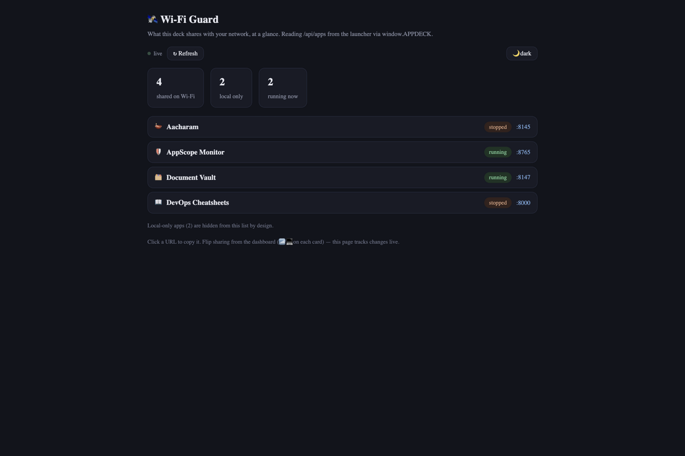

---

## Running it

```sh
./build.sh          # builds every app for the host platform + the launcher
./appdeck           # the dashboard opens its own window
```

Dev loop: `./build.sh --app <name>` rebuilds one app, then restart it from
the card. Cross-platform release zips: `./release.sh`.
