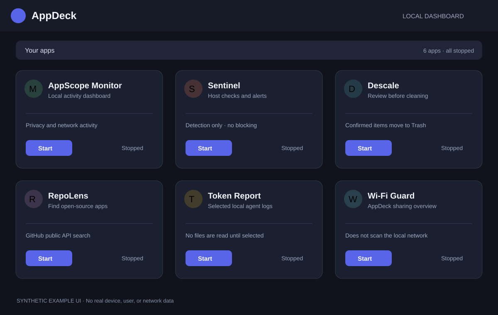

# AppDeck

AppDeck is a local dashboard for starting and opening the apps in the sibling
`Apps/` folder. The setup below is for someone running the project for the
first time on their own computer.



*Privacy-safe UI preview: synthetic example data only; it is not a capture of a
real workstation.*

## Before you start

- Install **Go 1.27 or later** from [go.dev/dl](https://go.dev/dl/).
- Install Git if you are downloading the source repositories yourself.
- Keep the launcher and app folders beside each other:

  ```text
  your-workspace/
  ├── Appdeck/
  └── Apps/
      ├── AppScopeMonitor/
      ├── Sentinel/
      ├── Descale/
      ├── RepoLens/
      ├── TokenReport/
      └── WifiGuard/
  ```

Check that Go is available:

```sh
go version
```

On Windows, run these commands in PowerShell or Windows Terminal. On macOS
and Linux, use Terminal.

## Start AppDeck from source

Open a terminal in the `Appdeck` folder and run:

```sh
go run .
```

AppDeck starts its local dashboard at <http://127.0.0.1:9090> and may open it
for you. If it does not, open that address in your browser. Leave the terminal
running while you use the dashboard. Press **Ctrl+C** in that terminal to stop
the launcher and the apps it started.

The first start can take longer because Go downloads the launcher's
dependencies and builds apps when you start them. You do not have to build
each app in advance.

## Open one of the included apps

Find the app card in the dashboard and select **Start**, then **Open**. Start
AppScope Monitor before Sentinel if you want Sentinel to include the monitor's
connection and privacy-event data. Each app's README has its own setup,
features, and limitations:

| App | What it does |
|---|---|
| [AppScope Monitor](../Apps/AppScopeMonitor/README.md) | Local privacy, device, and network activity dashboard |
| [Sentinel](../Apps/Sentinel/README.md) | Host-security checks and alerts; it does not block traffic |
| [Descale](../Apps/Descale/README.md) | Reports cleanup candidates and moves confirmed items to Trash |
| [RepoLens](../Apps/RepoLens/README.md) | Searches GitHub for open-source apps |
| [Token Report](../Apps/TokenReport/README.md) | Reads AI-agent usage logs you choose in the browser |
| [Wi-Fi Guard](../Apps/WifiGuard/README.md) | Shows which AppDeck apps are shared on your Wi-Fi |

Some apps need Go to build the first time. Static apps are hosted by AppDeck.
AppDeck keeps app data and logs in its user data directory rather than
requiring you to edit source files.

## Build a launcher binary (optional)

For a reusable local executable, run this from `Appdeck/`:

```sh
go build -o appdeck .
./appdeck
```

On Windows, use:

```powershell
go build -o appdeck.exe .
.\appdeck.exe
```

The source-run and locally built versions use the folders next to this
repository. Release packages have a separate, embedded-app build process.

## Network and privacy

The dashboard is intended for your own computer. AppDeck can share eligible
apps on your local Wi-Fi; sharing is not needed for ordinary use. Leave an
app's Wi-Fi sharing switch off unless you intentionally want other devices on
your network to reach it. Do not expose the dashboard or an app directly to
the public internet.

AppScope Monitor and Sentinel inspect activity on the machine where they run.
Token Report reads only folders you explicitly select. Review each app's
README before granting operating-system permissions or selecting personal
data.

## Troubleshooting

- **`go: command not found`**: install Go, reopen the terminal, and retry
  `go version`.
- **Port 9090 is already in use**: stop the other local service using that
  port, then start AppDeck again.
- **An app does not appear**: check that its folder is under the sibling
  `Apps/` directory and contains its `app.json`.
- **An app fails to start**: open its dashboard log and confirm that Go can
  download its dependencies.
